# Creating DHL Application

## Overview

This guide walks you through creating a DHL Developer account and application to obtain the API credentials required for the Krista DHL Tracking Extension. You'll create an account, set up an application, and retrieve your API key.

## Prerequisites

- Valid email address for account registration
- Business or personal information for account creation
- Purpose for using DHL tracking API

## What You'll Create

By the end of this guide, you will have:
- ✅ DHL Developer Account
- ✅ DHL Application with "Shipment Tracking - Unified" API enabled
- ✅ DHL API Key for authentication
- ✅ Service URL for API access

---

## DHL Developer Portal


The **DHL Developer Portal** ([https://developer.dhl.com/](https://developer.dhl.com/)) is DPDHL's central hub for accessing APIs across all its business divisions. It provides:
- Easy API discovery and subscription
- Application management
- API key generation and management
- Documentation and testing tools
- Usage analytics

---

## Step 1: Creating a DHL Developer Account

> **📝 Note**: If you already have a DHL Developer account, skip to [Step 2: Creating an Application](#step-2-creating-an-application).

### 1.1 Access the Sign-Up Page

1. Navigate to [https://developer.dhl.com/](https://developer.dhl.com/)
2. Click the **"Sign Up"** button in the top right corner

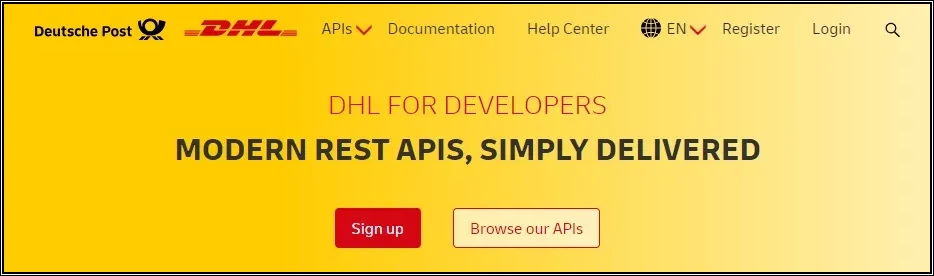

### 1.2 Fill Out Registration Form

1. Complete all required fields in the registration form:
   - **Email Address**: Your business or personal email
   - **Password**: Strong password (min 8 characters, uppercase, lowercase, numbers)
   - **First Name**: Your first name
   - **Last Name**: Your last name
   - **Company** (optional): Your organization name
   - **Country**: Your country of residence

2. Accept the Terms of Service and Privacy Policy
3. Click **"Create Account"** or **"Sign Up"**

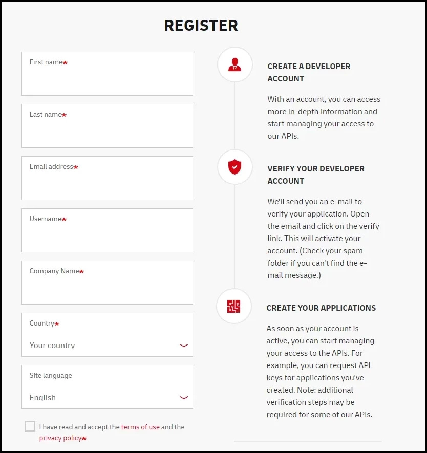

> **⚠️ Warning**: Use a valid email address - you'll need to verify it to activate your account.

### 1.3 Verify Your Email

1. Check your email inbox for a verification message from DHL
2. Click the verification link in the email
3. Your account will be activated

> **💡 Tip**: Check your spam folder if you don't receive the email within 5 minutes.

### 1.4 Log In to Your Account

1. Return to [https://developer.dhl.com/](https://developer.dhl.com/)
2. Click **"Sign In"**
3. Enter your email and password
4. Click **"Log In"**


5. You'll be redirected to the Developer Portal dashboard

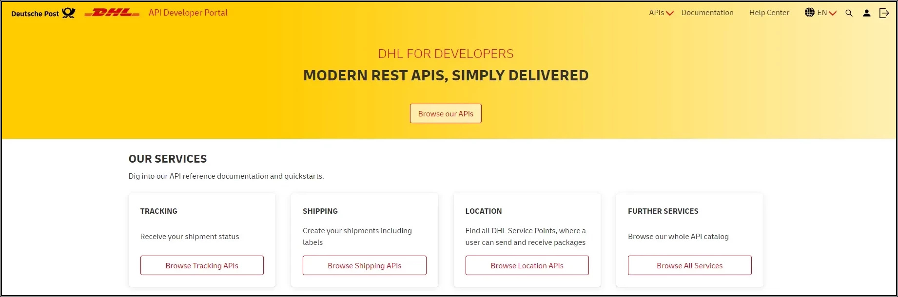

> **✅ Success**: Your DHL Developer account is now active!

---

## Step 2: Creating an Application

Applications in the DHL Developer Portal are containers for API subscriptions and credentials. Each application has its own API key.

### 2.1 Navigate to Apps Section

1. Click on your **user icon** in the top right corner of the screen
2. Select **"My Apps"** or **"Applications"** from the dropdown menu

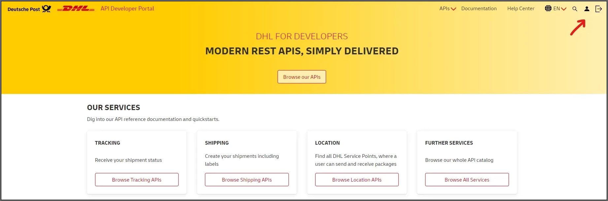

3. The **APPS** page will load, showing your existing applications (if any)

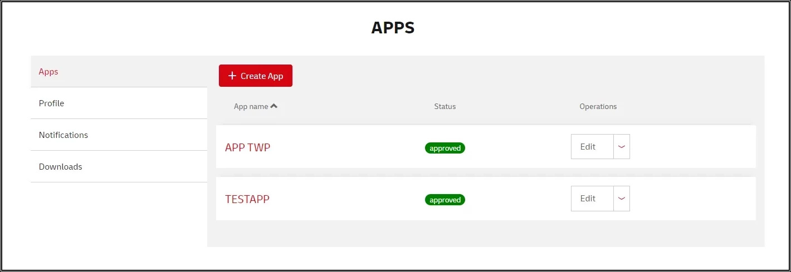

### 2.2 Create New Application

1. Click the **"Create App"** button (usually red or prominent color)


2. The **CREATE APP** form will be displayed

### 2.3 Fill Out Application Details

1. **App Name**: Enter a descriptive name for your application
   - Example: "Krista DHL Tracking Integration"
   - Example: "Production Tracking System"
   - Example: "Customer Service Portal"

2. **Description**: Add a brief description of your application's purpose
   - Example: "Integration with Krista platform for real-time DHL shipment tracking"

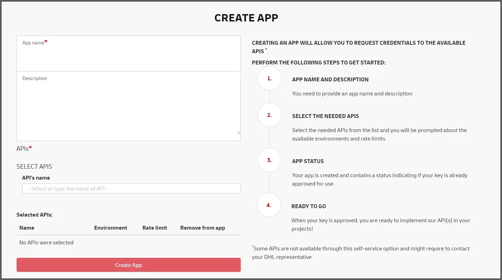

> **💡 Tip**: Use descriptive names to easily identify applications later, especially if you plan to create multiple apps for different environments (dev, test, prod).

### 2.4 Select APIs

1. In the **SELECT APIS** section, use the search box
2. Type: **"tracking unified"**
3. Locate the API: **"Shipment Tracking - Unified"**
4. Click the **"+"** button next to the API to add it to your application

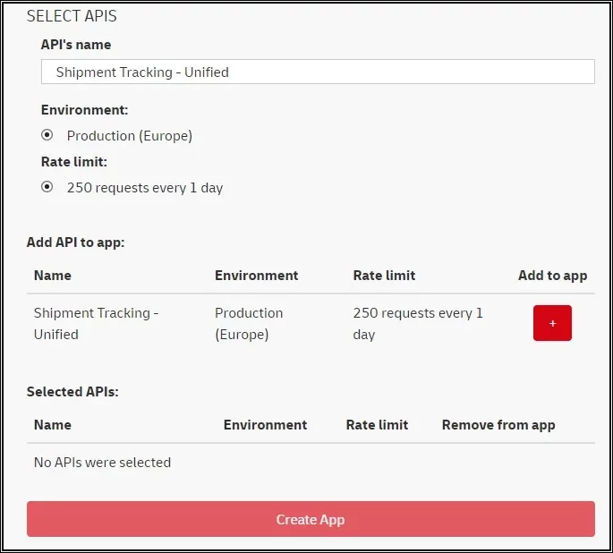

> **📝 Note**: The "Shipment Tracking - Unified" API is required for the Krista DHL Tracking Extension to function.

5. Verify the API appears in your selected APIs list

### 2.5 Create the Application

1. Review your application details and selected APIs
2. Click the **"Create App"** button at the bottom of the form

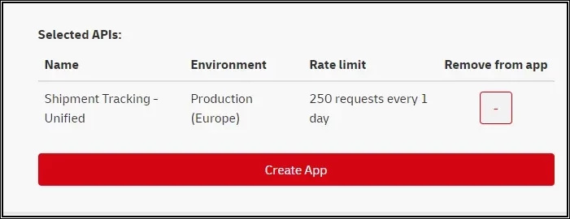

3. Wait for the application to be created (usually instant)
4. You'll be redirected to your application's details page

> **✅ Success**: Your DHL application is now created!

---

## Step 3: Retrieving the DHL API Key

Now that your application is created, you need to retrieve the API key to configure the Krista extension.

### 3.1 Navigate to Application Details

1. From the **APPS** page, click on the **name** of your newly created application

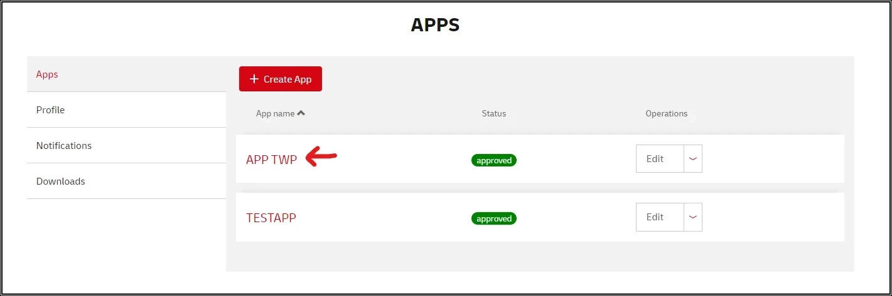

2. The application details page will load, showing:
   - Application name and description
   - Subscribed APIs
   - Credentials section
   - Usage statistics (if available)

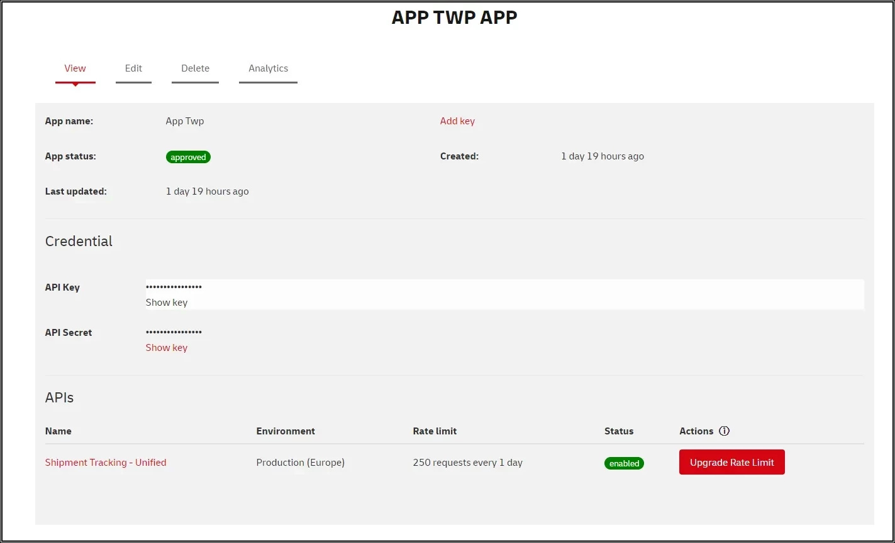

### 3.2 Reveal the API Key

1. Locate the **Credentials** section on the application details page
2. Find the **API KEY** field
3. Click the **"Show"** button or eye icon next to the API KEY

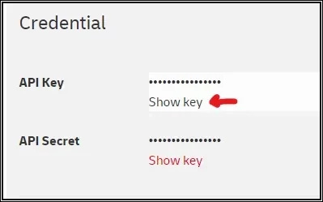

4. The API key will be revealed (a long alphanumeric string)

### 3.3 Copy the API Key

1. Click the **"Copy"** button next to the API key, or
2. Manually select and copy the entire API key string

**Example API Key Format**:
```
WNVFKVnpfZNGJFxwjB7Q4AItMPcJJOG7
```

> **⚠️ Warning**: Keep your API key secure! Treat it like a password:
> - Never share it publicly
> - Don't commit it to version control
> - Don't include it in screenshots or documentation
> - Rotate it regularly (every 90 days recommended)

### 3.4 Note the Service URL

The Service URL for DHL API varies by region. For European operations, use:

```
https://api-eu.dhl.com
```

**Regional URLs**:
- **Europe**: `https://api-eu.dhl.com`
- **Americas**: `https://api-am.dhl.com` (if available)
- **Asia Pacific**: `https://api-ap.dhl.com` (if available)

> **📝 Note**: Most users will use the European endpoint (`https://api-eu.dhl.com`). Check DHL documentation for region-specific URLs.

---

## Verification

Before proceeding to configure the Krista extension, verify you have:

- ✅ DHL Developer Account (active and verified)
- ✅ DHL Application created
- ✅ "Shipment Tracking - Unified" API enabled for your application
- ✅ API Key copied and stored securely
- ✅ Service URL noted (`https://api-eu.dhl.com`)

---

## Next Steps

Now that you have your DHL API credentials, proceed to:

1. **[Configure the Extension](pages/ExtensionConfiguration.md)** - Set up the extension in Krista
2. **Test the Connection** - Verify your credentials work correctly
3. **Start Tracking** - Use the [Track by Tracking Number](pages/TrackByTrackingNumber.md) catalog request

---

## Troubleshooting

### Issue: Cannot Create Application

**Cause**: Account not fully verified or permissions issue

**Solution**:
1. Verify your email address
2. Complete all required profile information
3. Log out and log back in
4. Contact DHL support if issue persists

---

### Issue: "Shipment Tracking - Unified" API Not Available

**Cause**: API not available in your region or account type

**Solution**:
1. Check if you're logged in
2. Verify your account type supports this API
3. Contact DHL support to enable the API
4. Check DHL documentation for alternative APIs

---

### Issue: Cannot See API Key

**Cause**: Permissions issue or application not fully created

**Solution**:
1. Refresh the page
2. Navigate away and back to the application
3. Verify application was created successfully
4. Check if you're the application owner
5. Try creating a new application

---

### Issue: API Key Not Working

**Cause**: Key not activated or incorrect permissions

**Solution**:
1. Wait 5-10 minutes after creating the application
2. Verify "Shipment Tracking - Unified" API is enabled
3. Check if you copied the entire key (no spaces)
4. Try regenerating the API key
5. Verify your DHL account is active

---

## Security Best Practices

### API Key Management

1. **Secure Storage**: Store API keys in secure credential management systems
2. **Environment Separation**: Use different API keys for dev, test, and production
3. **Regular Rotation**: Rotate API keys every 90 days
4. **Access Control**: Limit who can access API keys
5. **Monitoring**: Monitor API key usage for suspicious activity

### Regenerating API Keys

If your API key is compromised:

1. Go to your application in the DHL Developer Portal
2. Find the **Credentials** section
3. Click **"Regenerate"** or **"Revoke"**
4. Copy the new API key
5. Update the key in Krista extension configuration
6. Test the connection

> **⚠️ Warning**: Regenerating an API key immediately invalidates the old key. Update all systems using the old key.

---

## Additional Resources

- **DHL Developer Portal**: [https://developer.dhl.com/](https://developer.dhl.com/)
- **DHL API Documentation**: [https://developer.dhl.com/api-reference](https://developer.dhl.com/api-reference)
- **DHL Support**: Contact through Developer Portal
- **Krista Extension Configuration**: [Extension Configuration Guide](pages/ExtensionConfiguration.md)

---

## See Also

- [Extension Configuration](pages/ExtensionConfiguration.md) - Configure the extension in Krista
- [Track by Tracking Number](pages/TrackByTrackingNumber.md) - Main catalog request
- [Architecture](pages/Architecture.md) - Technical architecture and design