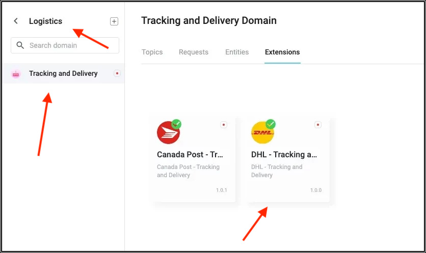
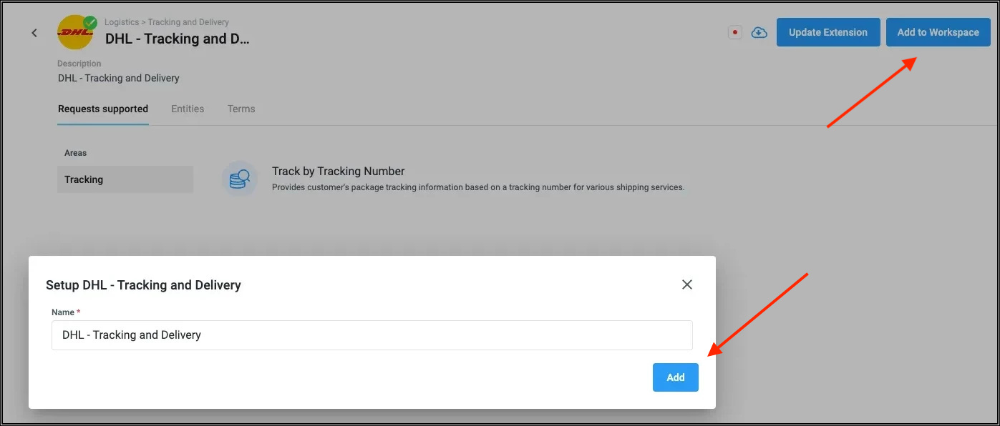
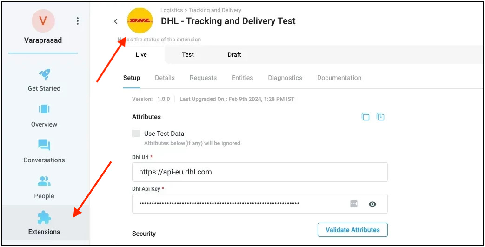
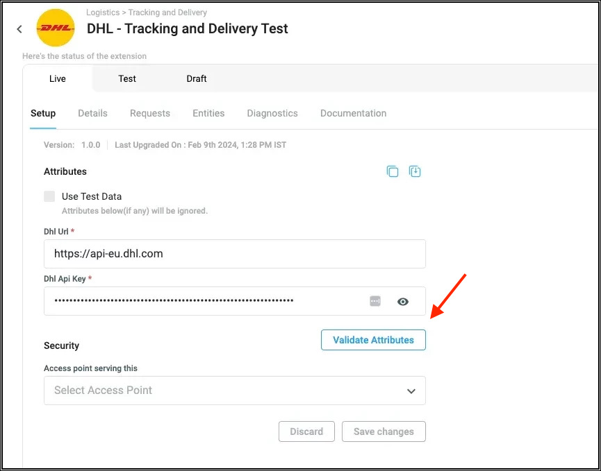
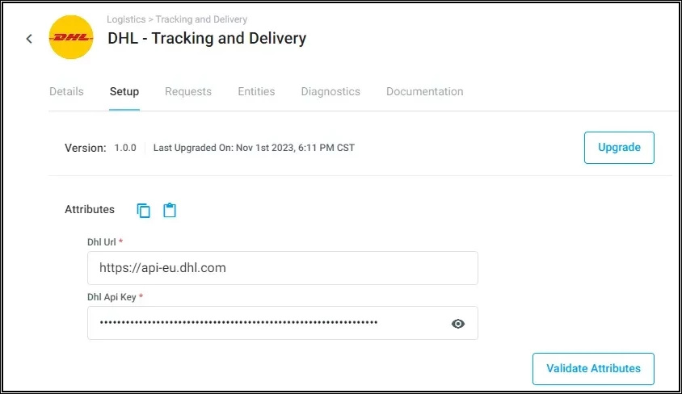
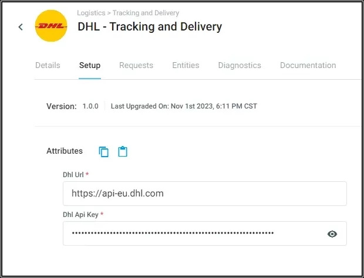
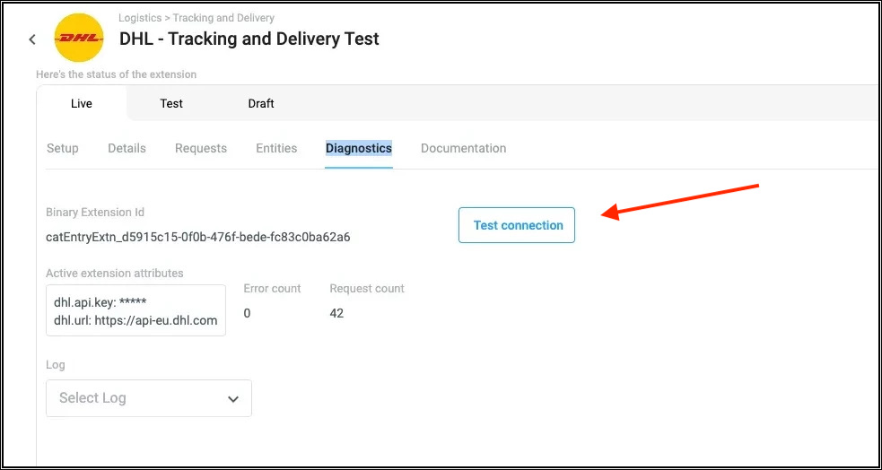

# Extension Configuration

## Overview

This guide provides step-by-step instructions for configuring the DHL Tracking and Delivery Extension in Krista. Before proceeding, ensure you have obtained your DHL API credentials by following the [Creating DHL Application](pages/CreatingDHLApp.md) guide.

## Prerequisites

Before configuring the extension, you must have:
- Active DHL Developer Account
- DHL Application created with "Shipment Tracking - Unified" API enabled
- DHL API Key
- Krista Platform access with extension management permissions

## Configuration Parameters

| Parameter | Type | Required | Description | Example |
|-----------|------|----------|-------------|---------|
| Service URL | Text | Yes | DHL API base URL for your region | `https://api-eu.dhl.com` |
| API KEY | Text (Secured) | Yes | DHL API key from your application | `WNVFKVnpfZNGJFxwjB7Q4AItMPcJJOG7` |

### Parameter Details

#### Service URL
- **Type**: Text
- **Required**: Yes
- **Format**: Full HTTPS URL
- **Production URL**: `https://api-eu.dhl.com` (Europe region)
- **Validation**: Must be a valid URL format

> **📝 Note**: The Service URL varies by region. Use `https://api-eu.dhl.com` for European operations.

#### API KEY
- **Type**: Text (Secured - will be masked in UI)
- **Required**: Yes
- **Format**: Alphanumeric string
- **Source**: DHL Developer Portal > Your App > Credentials
- **Security**: Stored encrypted in Krista

> **⚠️ Warning**: Never share your API key or commit it to version control. Treat it as a password.

## Step-by-Step Setup

### Step 1: Add Extension to Workspace

1. Navigate to **Catalogs** in the Krista platform
2. Select **Logistics** ecosystem
3. Choose **Tracking and Delivery** domain
4. Click on **DHL - Tracking and Delivery** extension



5. Click the **"Add to Workspace"** button
6. Enter a descriptive name for your extension instance (e.g., "DHL Tracking - Production")
7. Click **"Save"**



> **💡 Tip**: Use descriptive names if you plan to have multiple instances (e.g., "DHL Tracking - Test", "DHL Tracking - Production")

---

### Step 2: Navigate to Extension Setup

1. Go to **Extensions** in the main navigation
2. Find and click on **DHL - Tracking and Delivery**
3. Click on the **Setup** tab



---

### Step 3: Enter Configuration Parameters

1. In the **Service URL** field, enter: `https://api-eu.dhl.com`
2. In the **API KEY** field, paste your DHL API key from the Developer Portal
3. Do not click Save yet - proceed to validation first



**Example Configuration**:
```
Service URL: https://api-eu.dhl.com
API KEY: WNVFKVnpfZNGJFxwjB7Q4AItMPcJJOG7
```

> **⚠️ Warning**: Ensure there are no leading or trailing spaces in the API key.

---

### Step 4: Validate Attributes

1. Click the **"Validate Attributes"** button
2. A confirmation dialog will appear asking if the provided information is correct
3. Review your entries and click **"Yes"** to proceed



**What happens during validation**:
- URL format is validated
- API key is tested with a sample tracking request
- Connection to DHL API is verified
- Credentials are checked for proper permissions

4. If validation succeeds, a success message will appear at the bottom of the screen



5. If validation fails, review the error message and:
   - Verify API key is correct
   - Check Service URL format
   - Ensure API key has "Shipment Tracking - Unified" API enabled
   - Verify DHL account is active

---

### Step 5: Test Connection

1. Click the **"Test Connection"** button on the Setup page
2. The extension will perform a test tracking request to verify full functionality
3. Wait for the connection test to complete



4. If the test succeeds, you'll see a success message
5. The extension is now ready to use

> **✅ Success**: You can now use the extension's catalog requests to track DHL shipments!

---

## Security Considerations

### API Key Security
- **Never log or display** the API key in plain text
- **Rotate keys regularly** (every 90 days recommended)
- **Use separate keys** for development and production environments
- **Revoke compromised keys** immediately from DHL Developer Portal

### Network Security
- All API calls use **HTTPS encryption**
- SSL certificates are validated
- API keys are transmitted securely via headers

### Access Control
- Limit extension configuration access to authorized administrators
- Use Krista's role-based access control
- Audit configuration changes

## Troubleshooting

### Issue: "Invalid URL" Error

**Cause**: Service URL is malformed or incorrect

**Solution**:
1. Verify URL is exactly: `https://api-eu.dhl.com`
2. Ensure no trailing slashes
3. Check for typos
4. Confirm HTTPS protocol (not HTTP)

---

### Issue: "Invalid Login Credentials" Error

**Cause**: API key is incorrect, expired, or lacks permissions

**Solution**:
1. Verify API key from DHL Developer Portal
2. Ensure "Shipment Tracking - Unified" API is enabled for your app
3. Check if API key has been regenerated (old key would be invalid)
4. Verify DHL account is active and not suspended
5. Try regenerating the API key

---

### Issue: Validation Succeeds but Test Connection Fails

**Cause**: API key works for validation but fails for actual tracking

**Solution**:
1. Check DHL API status at [https://developer.dhl.com/](https://developer.dhl.com/)
2. Verify network connectivity
3. Check firewall settings
4. Review DHL API rate limits
5. Wait a few minutes and retry

---

### Issue: Cannot Save Configuration

**Cause**: Missing required fields or validation not completed

**Solution**:
1. Ensure both Service URL and API KEY are filled
2. Complete "Validate Attributes" step before saving
3. Check for browser console errors
4. Try refreshing the page and re-entering credentials

---

## Next Steps

After successful configuration:

1. **Test the Extension**: Try the [Track by Tracking Number](pages/TrackByTrackingNumber.md) catalog request
2. **Review Architecture**: Understand the [technical architecture](pages/Architecture.md)
3. **Integrate with Workflows**: Use the extension in your Krista applications
4. **Monitor Usage**: Track API calls and performance

## See Also

- [Creating DHL Application](pages/CreatingDHLApp.md) - How to obtain API credentials
- [Track by Tracking Number](pages/TrackByTrackingNumber.md) - Main catalog request documentation
- [Architecture](pages/Architecture.md) - Technical architecture and design
- [DHL API Documentation](https://developer.dhl.com/) - Official DHL API reference